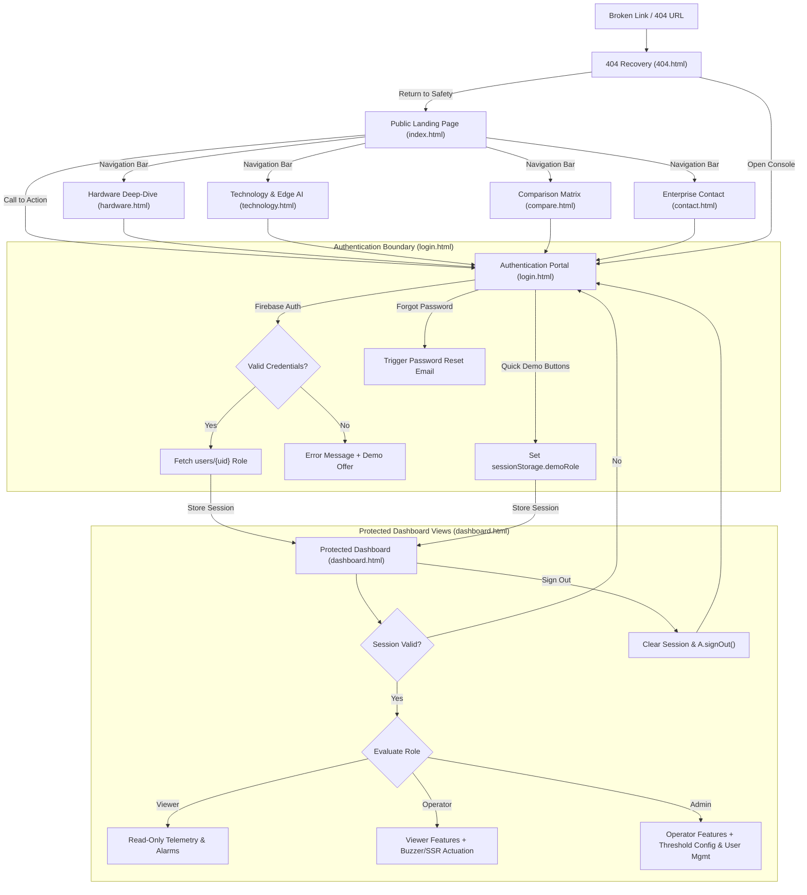

# AgniNode Web Platform - Architecture, File Map & Navigation Workflow

This document provides a comprehensive technical blueprint of the `AgniNode_Website` frontend architecture, detailing project files, page transition mechanics, authentication state handling, role-based access control (RBAC), and protected dashboard operations.

---

## 1. Comprehensive Project File Map

```text
AgniNode_Website/
├── .firebaserc                     # Firebase active project binding (agninode-e0242)
├── .gitignore                      # Ignore node_modules, temp caches, and logs
├── .prettierrc.json                # Code style specification (single quotes, 2 spaces, 100 col)
├── firebase.json                   # Firebase Hosting headers, cleanUrls, and Firestore routing
├── firestore.indexes.json          # Compound query indexing for telemetry timestamps
├── firestore.rules                 # Role-based Firestore security rules (viewer/operator/admin/device)
├── package.json                    # Workspace metadata, start/dev commands, and Prettier scripts
├── README.md                       # Quickstart instructions and deployment guide
├── server.js                       # Lightweight local HTTP/1.1 static server with Range support (port 3000)
├── NAVIGATION_WORKFLOW.md          # Architectural file map and navigation documentation (this file)
└── public/                         # Production static web root (served by Firebase and server.js)
    ├── 404.html                    # Branded error recovery page with auto-redirect
    ├── compare.html                # Technical benchmark matrix vs. legacy detection systems
    ├── contact.html                # Inquiries, pilot deployment request, and enterprise form
    ├── dashboard.html              # Protected real-time telemetry dashboard & command center
    ├── favicon.svg                 # Vector flame and electrical safety favicon
    ├── hardware.html               # Interactive 3D product render, layer viewer & hardware pin map
    ├── index.html                  # High-conversion public landing page with live status preview
    ├── login.html                  # Authentication portal with email/pass & role-based demo bypass
    ├── robots.txt                  # Search engine crawl directives
    ├── site.webmanifest            # Progressive Web App (PWA) manifest
    ├── sitemap.xml                 # XML sitemap for SEO discovery
    ├── technology.html             # Deep-dive on AFDD algorithms, RCCB logic, and dual-MCU safety
    ├── assets/
    │   ├── hardware/               # 3D models, CAD layers (Layer 1-7), transparent renders
    │   ├── images/                 # App mockups, schematics, panel mounts, branded vector logos
    │   └── videos/                 # 360-degree exploded product videos and operational demos
    ├── css/
    │   ├── dashboard.css           # Dashboard grid layout, oscilloscope canvas, alarms, theme tokens
    │   └── site.css                # Global design system, glassmorphism UI, typography, navigation
    └── js/
        ├── config.js               # Firebase Client SDK credentials and DEMO flag detection
        ├── dashboard.js            # Real-time Firestore sync, 60 FPS oscilloscope, Web Audio siren
        ├── login.js                # Auth state observer, form validation, password reset, demo routing
        └── site.js                 # Global navbar behaviors, mobile drawer, scroll animations
```

---

## 2. Navigation Workflow & User Journey

The web platform is architected around two operational zones:

1. **Public Marketing & Technology Discovery Funnel**: High-performance static pages optimized for zero-latency loading and SEO.
2. **Authenticated IoT Monitoring & Control Zone**: Protected, real-time client-side application connected to Firebase Auth and Firestore.



---

## 3. Page Specifications & Transitions

### 3.1 Public Landing Page (`index.html`)

- **Purpose**: Brand introduction, live system preview, primary value proposition (microsecond fire and electrical arc detection).
- **Outbound Transitions**:
  - `hardware.html`: Links from "Hardware Architecture" hero buttons and navbar.
  - `technology.html`: Links from "Edge Detection Algorithms" card.
  - `compare.html`: Links from "Why AgniNode" section.
  - `contact.html`: Links from footer and "Request Pilot Deployment" buttons.
  - `login.html`: Links from the primary "Launch Dashboard" navigation button.

### 3.2 Product Hardware Explorer (`hardware.html`)

- **Purpose**: Interactive CAD exploded view, component bill of materials (BOM), sensor placement diagrams, and physical pin descriptions.
- **Interactive Elements**:
  - Layer-by-layer PCB viewer (Layer 1 Baseplate up to Layer 7 Optical Flame Filter).
  - Microcontroller specification switch (STM32G0B1RE vs ESP32-WROOM-32E).
- **Outbound Transitions**: Links back to `index.html` or forwards to `technology.html` and `login.html`.

### 3.3 Technology & Algorithms (`technology.html`)

- **Purpose**: Deep mathematical and firmware explanation of the AFDD (Arc Fault Detection Device) algorithm, the dual-CT RCD/RCCB earth leakage engine, and the aerosol fire suppression trigger matrix.
- **Outbound Transitions**: Direct links to `compare.html` and `login.html`.

### 3.4 Comparison Matrix (`compare.html`)

- **Purpose**: Competitive evaluation comparing AgniNode with conventional optical smoke detectors, standard circuit breakers (MCBs), and standalone thermal sensors.
- **Outbound Transitions**: Call-to-action buttons leading to `contact.html` and `login.html`.

### 3.5 Enterprise Contact & Inquiries (`contact.html`)

- **Purpose**: Form for industrial facility managers, panel builders, and OEM partners to request hardware samples, pricing, and system integration guides.
- **Outbound Transitions**: Submitting the form validates inputs locally and redirects or confirms status.

### 3.6 404 Recovery (`404.html`)

- **Purpose**: Catches missing or mistyped routes. Matches the glassmorphism theme and provides one-click links to `index.html` or `dashboard.html`.

---

## 4. Authentication Flow & Role-Based Access Control (`login.html` -> `dashboard.html`)

### 4.1 Login Mechanism (`login.js`)

1. **Firebase Initialization**: Dynamically imports Firebase 10.12.2 modules (`firebase-app.js`, `firebase-auth.js`) using credentials configured in `config.js`.
2. **Session Pre-Check**:
   ```javascript
   A.onAuthStateChanged(auth, (user) => {
     if (user) {
       sessionStorage.removeItem('demoRole');
       location.replace('dashboard.html');
     }
   });
   ```
3. **Authentication Modes**:
   - **Production Authentication**: User submits email and password. `A.signInWithEmailAndPassword(auth, email, password)` contacts Firebase Auth. Upon success, the auth state change fires and redirects to `dashboard.html`.
   - **Role-Based Demo Bypass**: For review, demonstrations, and offline testing, clicking "Admin Demo", "Operator Demo", or "Viewer Demo" sets `sessionStorage.setItem('demoRole', '<role>')` and redirects immediately to `dashboard.html`.
   - **Self-Healing Auth Failure**: If real authentication fails (e.g., wrong password or offline), the error banner offers an instant one-click link to proceed with the corresponding demo role.
   - **Password Reset**: Clicking "Forgot password?" sends a reset email via `A.sendPasswordResetEmail(auth, email)`.

---

## 5. Protected Dashboard Views & Engine Capabilities (`dashboard.html`)

### 5.1 Authentication Guard & Initial Handshake

Upon loading `dashboard.html`, `dashboard.js` validates the active session:

- If a Firebase Auth user is present, it queries Firestore document `users/{uid}` to read the assigned `role`.
- If no Firebase user is present, it inspects `sessionStorage.getItem('demoRole')`. If set, it operates in simulated demo mode.
- If neither is present, it invokes `location.replace('login.html')`.

### 5.2 Role-Based Permissions Matrix

| Capability / Action                                 | Viewer (`viewer`) | Operator (`operator`) | Administrator (`admin`) |
| :-------------------------------------------------- | :---------------: | :-------------------: | :---------------------: |
| Real-time Telemetry (Temp, Smoke, Current, Voltage) |     Read-Only     |       Read-Only       |        Read-Only        |
| 60 FPS AC Oscilloscope Waveform Stream              |        Yes        |          Yes          |           Yes           |
| Historical Analytics Charts (Env / Elec / Safety)   |        Yes        |          Yes          |           Yes           |
| Acknowledge Warning / Alarm Banners                 |        Yes        |          Yes          |           Yes           |
| Toggle Audible Piezo Buzzer (Manual Test)           |        No         |          Yes          |           Yes           |
| Arm / Disarm Fire Suppression Canister              |        No         |          Yes          |           Yes           |
| Reset Tripped Mains Contactor / Breaker             |        No         |          Yes          |           Yes           |
| Fault Injection Simulation (Arc, Shock, Leakage)    |        No         |          Yes          |           Yes           |
| Adjust Sensor Thresholds & Trip Tolerances          |        No         |          No           |           Yes           |
| User Management & Role Assignment Table             |        No         |          No           |           Yes           |
| System Reboot & Remote OTA Firmware Trigger         |        No         |          No           |           Yes           |

### 5.3 Live Real-Time Systems & Rendering Engines

1. **Firestore Real-Time Data Sync**: Subscribes via `onSnapshot` to the `devices` collection and active device status paths (`devices/{id}/status/live`, `devices/{id}/status/analysis`, `devices/{id}/alerts`). Updates UI elements reactively.
2. **60 FPS Real-Time AC Oscilloscope**:
   - An HTML5 Canvas (`#oscCanvas`) renders a real-time dual-trace oscilloscope (Trace 1: Voltage 230V RMS, Trace 2: Current 12A RMS).
   - Dynamically renders true sinusoidal waveforms, harmonic distortions, high-frequency arc noise bursts, and current phase shifts based on incoming STM32 telemetry or simulation states.
3. **Analytical Sub-Views**:
   - **Environmental View**: Real-time gauge dials for ambient temperature (°C), relative humidity (%RH), optical smoke chamber density (ADC counts), and thermal rate-of-rise (°C/min).
   - **Electrical Protection View**: Vrms voltage, line current ($I_L$), neutral current ($I_N$), residual earth leakage ($I_{res}$ in mA), grid frequency (Hz), power factor ($\cos \phi$), and active power (W).
   - **Safety Diagnostic View**: AFDD high-frequency 2nd difference noise energy, cycle-to-cycle waveform disparity score, RCD trip integration frames, and actuator relay health readbacks.
4. **Industrial Web Audio Fire Siren**:
   - Built with the Web Audio API (`AudioContext`).
   - When status reaches `ALARM` or `FIRE`, generates a dual-frequency alternating acoustic tone (880 Hz / 659 Hz warble with 3.5 Hz modulation).
   - Includes user acknowledgment and manual mute button with audio context auto-resume on first interaction.
5. **Downstream Command Queue**:
   - When an operator or admin triggers an action (e.g. buzzer test or suppression arming), the web app writes a new document to `devices/{id}/commands/{cmdId}` with fields `{ action, param, state: "PENDING", created: timestamp }`.
   - The ESP32 companion gateway polls or listens to this collection, relays the frame to the STM32 MCU, and updates the command document to `EXECUTED` upon receiving the hardware ACK.
