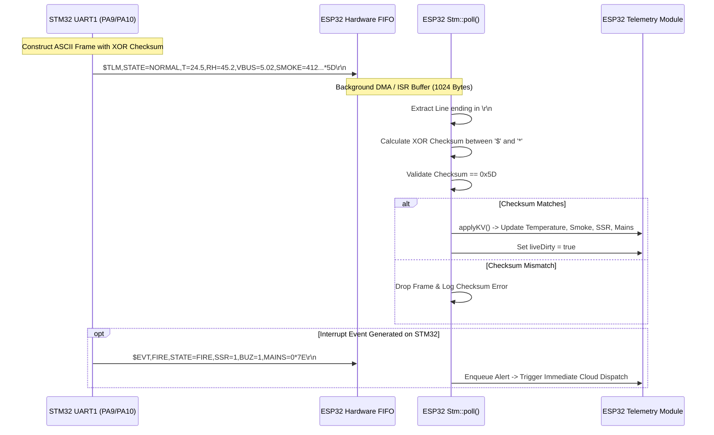
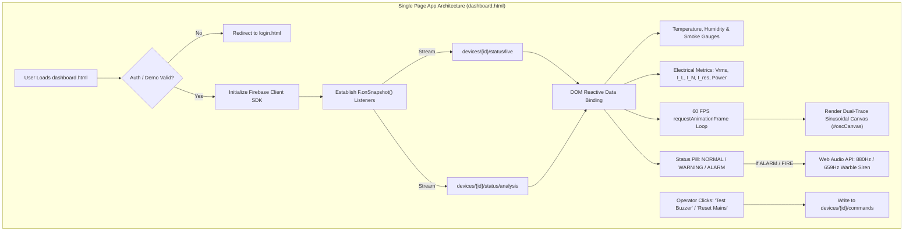

# AgniNode End-to-End System Workflow Architecture

## Executive Architectural Overview

The **AgniNode** platform is a mission-critical, hybrid-edge fire detection and electrical safety system designed for industrial distribution boards, switchgear enclosures, and commercial facilities. The system operates on a multi-tiered architecture:

```
[ Electrical & Environmental Sensors ]
                  │
                  ▼
   [ STM32G0B1RE Safety Firmware ]  <─── High-speed ADC, DMA, Hardware Interlocks
                  │
        UART Link (115200 8N1)
                  │
                  ▼
     [ ESP32 Companion Gateway ]     <─── Wi-Fi, TLS 1.2, FreeRTOS, OTA Manager
                  │
          HTTPS / REST (TLS)
                  │
                  ▼
     [ Firebase Cloud Firestore ]    <─── Real-time Document Database, Auth & Rules
                  │
            WebSocket / WSS
                  │
                  ▼
 [ Web Dashboard (Single Page App) ] <─── 60 FPS Oscilloscope, Audio Siren, RBAC
```

---

## 1. Initial Power-Up & Hardware Initialization

```mermaid
sequenceDiagram
    autonumber
    participant PWR as Power Rails (3.3V / 5V)
    participant STM as STM32G0B1RE (Safety MCU)
    participant ESP as ESP32 (Gateway)
    participant CLD as Firebase Cloud

    PWR->>STM: Power Applied (VDD 3.3V)
    PWR->>ESP: Power Applied (VIN 5V)

    rect rgb(20, 25, 40)
        Note over STM: STM32 Boot Sequence (64 MHz)
        STM->>STM: Reset_Handler -> SystemInit()
        STM->>STM: Read Reset Flags (IWDG, PIN, SOFT, POWER)
        STM->>STM: clock_config() -> HSI16 + PLL -> 64 MHz SYSCLK
        STM->>STM: gpio_init() -> SSRs OPEN (Fail-Safe), Buzzer OFF
        STM->>STM: uart_init() -> USART1 (115200) + RX/TX Rings
        STM->>STM: i2c_init() -> I2C1 100 kHz + SHT31 Bus Check
        STM->>STM: acq_init() -> TIM3 (12.8 kHz) + DMA + ADC1 Calibration
        STM->>STM: hiwdg -> Independent Watchdog Armed (4.0s)
        STM->>STM: Delay 3000ms -> Self-Check Pass -> Close Mains SSR (PB2)
    end

    rect rgb(25, 35, 30)
        Note over ESP: ESP32 Boot Sequence (240 MHz)
        ESP->>ESP: Bootloader -> Dual-Core Xtensa Start
        ESP->>ESP: OtaEsp32::bootCheck() (Rollback safety check)
        ESP->>ESP: Task WDT Armed (90s)
        ESP->>ESP: LittleFS.begin()
        ESP->>ESP: Stm::begin() -> UART2 RX/TX (1024B Buffer)
        ESP->>ESP: Net::begin() -> Wi-Fi Connect + SNTP Sync
        ESP->>CLD: Auth::begin() -> Request JWT Token via REST
    end

    STM->>ESP: First Frame: $TLM,STATE=NORMAL...*CS\r\n
    ESP->>CLD: Initial Live Status Upload (PATCH /status/live)
```



### 1.1 STM32G0B1RE Safety Microcontroller Startup

1. **Power Rail Rise & Hardware Reset**:
   When 3.3V VDD stabilizes, the Cortex-M0+ core vectors to `Reset_Handler` in [`Core/Startup/startup_stm32g0b1retx.s`](file:///c:/Users/AVISHKAR/Downloads/AgniNode%20Project/AgniNode_STM/Core/Startup/startup_stm32g0b1retx.s). Data segments are unpacked to SRAM, BSS is zeroed, and execution transfers to `main()` in [`src/main.c`](file:///c:/Users/AVISHKAR/Downloads/AgniNode%20Project/AgniNode_STM/src/main.c).
2. **Reset Cause Identification**:
   `board_init()` queries RCC reset flags (`RCC_FLAG_IWDGRST`, `RCC_FLAG_SFTRST`, `RCC_FLAG_PWRRST`, `RCC_FLAG_PINRST`). The result is saved for telemetry (`"POWER"`, `"PIN"`, `"IWDG"`, `"SOFT"`) and flags are cleared.
3. **Clock Tree Configuration**:
   The internal 16 MHz High-Speed Internal oscillator (HSI16) is engaged. The PLL multiplies this by 8 and divides by 2 to generate a stable **64 MHz SYSCLK**, distributed to AHB and APB buses without prescaling. Flash access latency is configured to 2 wait states with instruction prefetch enabled.
4. **GPIO Fail-Safe Default Assertion**:
   All actuator control outputs are asserted to fail-safe default states before any peripheral logic executes:
   - `PB0` (Fire Suppression Aerosol Igniter SSR): Set to `GPIO_PIN_RESET` (0V). Pulled down internally.
   - `PB2` (Mains Contactor SSR): Set to `GPIO_PIN_RESET` (0V / Disconnected). Pulled down internally.
   - `PA6` (Audible Piezo Buzzer): Set to `GPIO_PIN_RESET` (0V / Muted).
   - `PA8` (RS-485 DE + /RE): Set to `GPIO_PIN_RESET` (Receive Mode).
   - `PA1` (Smoke D0) & `PA2` (Flame D0): Configured as Inputs with internal `PULLUP`.
5. **Peripheral Initialization**:
   - **USART1**: Configured for 115200 baud, 8 data bits, no parity, 1 stop bit (`8N1`). `PA9` (TX) and `PA10` (RX) are mapped via Alternate Function `AF1`. Ring buffers (`rx_ring` 256 bytes, `tx_ring` 1024 bytes) are initialized, and the RX interrupt (`USART_CR1_RXNEIE`) is enabled at NVIC priority 2.
   - **I2C1**: Configured at 100 kHz on `PB8` (SCL) and `PB9` (SDA) with analog noise filtering. An automated 9-clock recovery sequence (`board_i2c_recover()`) is executed to free any slave holding SDA low.
   - **Acquisition Timer (TIM3) & DMA1**: `TIM3` is configured in continuous up-counting mode to trigger an update event (`TIM_TRGO_UPDATE`) at exactly **12.8 kHz** (`Period = (64 MHz / 12800 Hz) - 1 = 4999`). `DMA1_Channel1` is bound to ADC1 in circular mode with high priority.
   - **ADC1 Subsystem**: 12-bit SAR ADC configured with a 16 MHz ADC clock (`PCLK/4`). Channels `PA0` (Vbus), `PA4` (Smoke A0), `PA5` (Line CT), `PA7` (Neutral CT), and `PB1` (ZMPT AC Voltage) are configured in ascending sequence. Built-in self-calibration (`HAL_ADCEx_Calibration_Start`) is executed before starting conversions.
   - **Independent Watchdog (IWDG)**: Clocked from the 32 kHz LSI clock with prescaler 64 (500 Hz). The reload value of 2000 establishes a hard **4.0-second hardware timeout** requiring regular refreshes (`board_wdg_kick()`).
6. **Mains Auto-Close Interlock**:
   The mains SSR on `PB2` remains open on boot. After a non-blocking delay of `MAINS_AUTO_CLOSE_DELAY_MS` (3000 ms), firmware validates that no fire, over-current, or sensor faults exist, then asserts `PB2` HIGH to close the mains contactor and energize the load safely.

---

### 1.2 ESP32 Companion Gateway Startup

1. **Core Initialization & Reset Audit**:
   Upon power-up, the dual-core Xtensa LX6 starts FreeRTOS. Primary setup executes on Core 1 in [`src/main.cpp`](file:///c:/Users/AVISHKAR/Downloads/AgniNode%20Project/AgniNode_ESP/src/main.cpp). Serial0 (USB debug) starts at 115200 baud, printing the reset reason.
2. **OTA Boot Health Verification (`OtaEsp32::bootCheck`)**:
   Firmware inspects the active running partition (`app0` or `app1`). If running on a newly flashed image that has not yet been confirmed, boot attempt counters in non-volatile storage (NVS) are evaluated. If boot attempts exceed 3 without reaching stable cloud connectivity, the ESP32 automatically rolls back to the previous stable firmware partition.
3. **Watchdog & Storage**:
   The Task Watchdog Timer is armed with a 90-second timeout (`TASK_WDT_SECONDS`). The LittleFS filesystem is mounted to host offline cache files and staged firmware binaries.
4. **Inter-MCU Hardware Link**:
   Hardware Serial2 starts at 115200 baud on `GPIO 16` (RX) and `GPIO 17` (TX) with an expanded 1024-byte buffer. Hardware bootloader lines (`GPIO 4` to STM32 BOOT0, `GPIO 5` to STM32 NRST) are initialized to passive states (`BOOT0` LOW, `NRST` high-impedance INPUT).
5. **Network & Cloud Stack**:
   - `Net::begin()` initiates non-blocking Wi-Fi association using credentials from `secrets.h`.
   - SNTP client initializes with `pool.ntp.org` and `time.google.com` to acquire valid UNIX epoch timestamps.
   - `Auth::begin()` initializes the Firebase Auth state machine, deferring token acquisition until network connectivity and time synchronization are achieved.

---

## 2. Local Sensor Acquisition & Safety Logic (STM32)

```mermaid
flowchart TD
    subgraph ADC_DMA ["12.8 kHz DMA Acquisition Pipeline"]
        T3["TIM3 TRGO (12.8 kHz)"] --> ADC["ADC1 5-Channel Scan"]
        ADC --> DMA["DMA1 Circular Transfer"]
        DMA -->|Half Complete (20ms)| F0["Frame 0 Buffer (256 x 5)"]
        DMA -->|Complete (20ms)| F1["Frame 1 Buffer (256 x 5)"]
    end

    subgraph Analytical_Engine ["Electrical Safety Engine (src/analysis.c)"]
        F0 & F1 --> RMS["RMS Engine: Vrms, I_Line, I_Neutral"]
        RMS --> DIFF["Vector Residual: I_res = |I_Line - I_Neutral|"]
        DIFF --> RCD{"I_res >= 300mA?"}
        RCD -->|"Fast: >=1500mA (40ms)<br>Slow: >=300mA (200ms)"| TRIP_RCD["Trip Mains SSR (PB2 = LOW)"]

        RMS --> AFDD_CALC["2nd Difference: d2I = I_k - 2*I_{k-1} + I_{k-2}"]
        AFDD_CALC --> NOISE["Integrate HF Noise + Waveform Delta"]
        NOISE --> ARC{"Arc Score >= 30?"}
        ARC -->|"Yes"| TRIP_ARC["Trip Mains SSR (PB2 = LOW)"]
    end

    subgraph Environmental_Engine ["Environmental & Fire Logic (src/fire_logic.c)"]
        SHT["SHT31 (1 Hz I2C)"] --> TEMP["Temp (C) & Rate of Rise (C/min)"]
        MQ["Smoke A0 & D0"] --> SMOKE["Smoke Density (Counts)"]
        IR["Flame D0"] --> FLAME["Flame Detected"]

        TEMP & SMOKE & FLAME --> MATRIX{"Fire Decision Matrix"}
        MATRIX -->|Smoke + Flame| FIRE["STATE = FIRE"]
        MATRIX -->|Smoke + High Temp| FIRE
        MATRIX -->|Flame + High Temp| FIRE
        MATRIX -->|Flame + Temp Rate| FIRE
    end

    FIRE --> ACTUATE["1. Trip Mains SSR (PB2 = LOW)<br>2. Fire Suppression SSR (PB0 = HIGH)<br>3. Sound Buzzer (PA6 = HIGH)<br>4. Emit Immediate $EVT,FIRE"]
```

### 2.1 The 12.8 kHz Sampling Engine

Every 78.125 microseconds, `TIM3` triggers an ADC scan across 5 channels. At 12.8 kHz, exactly **256 samples per channel** are captured over each 20 millisecond period (one full 50 Hz AC cycle).

- DMA automatically pushes these into `adc_dma_buf`.
- When 1280 halfwords are filled (256 samples $\times$ 5 channels), the Half-Transfer interrupt fires, copying the completed cycle into an analytical frame queue without halting ongoing acquisitions.

### 2.2 AFDD (Arc Fault Detection Device) Mathematical Algorithm

Arc faults in electrical switchgear generate intermittent micro-discharges, high-frequency current noise, and non-periodic cycle distortion. The STM32 executes an in-line edge detection pipeline:

1. **Discrete Second Difference**:
   Firmware calculates the second difference of the normalized current waveform:
   $$\Delta^2 I_k = I_k - 2I_{k-1} + I_{k-2}$$
   This acts as a high-pass filter, stripping away the fundamental 50 Hz sinusoidal component and isolating high-frequency arc transients.
2. **High-Frequency Noise Integration**:
   The RMS sum of $\Delta^2 I_k$ is computed across the frame. If this noise metric exceeds `ARC_HF_ABS` (14 counts RMS) while line current is above `ARC_MIN_A` (1.5 A), high-frequency noise is flagged.
3. **Cycle-to-Cycle Waveform Disparity**:
   The current frame is compared sample-by-sample against the previous cycle:
   $$\Delta_{PM} = \frac{\sum |I_k - I_{prev, k}|}{\sum |I_k|} \times 1000$$
   Arcs exhibit irregular combustion dynamics causing erratic $\Delta_{PM}$ spikes ($> 150\text{ ‰}$).
4. **Current Rail Clipping**:
   Parallel arcs and severe flashovers drive the sensor into ADC saturation rails (`0` or `4095`). If $\ge 4$ clipped samples occur over $\ge 2$ consecutive frames, an immediate high-energy fault is registered.
5. **Trip Accumulator**:
   When combined noise and disparity criteria are met, an internal score increments. Upon reaching `ARC_TRIP_SCORE` (30), the MCU forces `PB2` LOW, tripping the mains breaker in under **100 milliseconds**.

### 2.3 Differential Earth Leakage (RCD / RCCB) Analysis

The system uses dual SCT-013-030A Current Transformers monitoring Line ($I_L$) and Neutral ($I_N$) conductors:

- Vector residual current is calculated in real time:
  $$I_{res} = |I_L + (\text{CT\_N\_POLARITY} \times I_N \times \text{Gain})|$$
- **Fast Shock Trip**: If $I_{res} \ge 5 \times 300\text{ mA}$ ($1.5\text{ A}$), firmware trips the mains SSR in **40 ms** (2 cycles).
- **Leaky Earth Fault Trip**: If $I_{res} \ge 300\text{ mA}$ persistently for **200 ms** (10 cycles), the mains breaker opens to prevent insulation degradation fire.

### 2.4 Multi-Sensor Fire Confirmation Matrix

To prevent false suppression activations, the STM32 applies multi-variable voting:

- **Smoke**: Analog ADC $\ge 2200$ counts (debounced 1.0s) or Digital D0 LOW.
- **Flame**: Optical 760–1100 nm sensor debounced for 0.3s.
- **Thermal**: Temperature $\ge 55^\circ\text{C}$ or Rate-of-Rise $\ge 8^\circ\text{C}/\text{min}$ over a 10s span.
- **Latching Action**: Any dual-sensor combination locks the state machine into `STATE_FIRE`:
  1. Opens mains contactor (`PB2` LOW) to eliminate electrical fuel.
  2. Asserts aerosol igniter (`PB0` HIGH) to flood the enclosure with extinguishing particulate.
  3. Drives piezo buzzer (`PA6` HIGH) in continuous alarm mode.
  4. Generates an immediate serial interrupt frame `$EVT,FIRE`.

---

## 3. High-Reliability Serial Communication (STM32 -> ESP32)



### 3.1 Framing Specification

Every transmission utilizes framed ASCII strings:

```text
$<TYPE>,<KEY1>=<VAL1>,<KEY2>=<VAL2>,...*<CHECKSUM_HEX>\r\n
```

The checksum is an 8-bit XOR calculated over all ASCII characters between `$` and `*`:
$$\text{Checksum} = \bigoplus_{i=1}^{N} \text{Byte}_i$$

### 3.2 Protocol Frame Types

1. **Periodic System Telemetry (`$TLM`)**: Sent every 2000 ms.
   ```text
   $TLM,STATE=NORMAL,T=24.8,RH=44.1,TRATE=0.1,VBUS=5.01,SMOKE=380,D0=0,FLAME=0,SSR=0,BUZ=0,ARM=0,TVALID=1,FAULT=0,FW=3.0.0,RST=POWER,MAINS=1,TRIP=0*5B
   ```
2. **High-Speed Electrical Analytics (`$ANL`)**: Sent every 1000 ms.
   ```text
   $ANL,V=230.2,IL=12.45,IN=12.44,IRES=0.010,IRESMAX=0.012,P=2840.5,PF=0.99,F=50.01,E=14.2,HF=3,DLT=12,ARC=0,RTHR=300*6B
   ```
3. **Interrupt Events (`$EVT`)**: Sent immediately when safety states transition.
   ```text
   $EVT,FIRE,STATE=FIRE,SSR=1,BUZ=1,MAINS=0,TRIP=4*7E
   ```
4. **Command Acknowledgment (`$ACK`)**: Confirms receipt and hardware execution of commands.
   ```text
   $ACK,10842,BUZZER,OK,ACTIVE*4A
   ```

---

## 4. Cloud Synchronization with Firebase (ESP32)

```mermaid
flowchart LR
    subgraph ESP_Sync ["ESP32 Telemetry Engine (src/telemetry.cpp)"]
        EVT["Alert Enqueued?"] -->|Yes (Immediate)| U_ALT["uploadAlert()"]
        SAMPLE["1 Hz Analysis Sample"] --> WIN["Buffer Window (10 Samples)"]
        TIMER["10s Upload Interval"] --> U_LIVE["uploadLive()"]
        TIMER --> U_WIN["uploadAnalysisWindow()"]
        TIMER -->|Every 60s| U_HIST["uploadHistory()"]
    end

    subgraph Firebase_REST ["Firebase Cloud Infrastructure (agninode-e0242)"]
        U_ALT -->|POST| F_ALT["/devices/agninode-001/alerts"]
        U_LIVE -->|PATCH| F_LIVE["/devices/agninode-001/status/live"]
        U_WIN -->|PATCH| F_ANL["/devices/agninode-001/status/analysis"]
        U_HIST -->|POST (TTL 14d)| F_READ["/devices/agninode-001/readings"]
    end

    subgraph Downlink_Queue ["Downlink Command Processing"]
        F_CMD["/devices/agninode-001/commands"] -->|Poll (3000ms)| C_POLL["Commands::service()"]
        C_POLL -->|Serial $CMD| STM_UART["STM32 USART1"]
        STM_UART -->|Serial $ACK| C_POLL
        C_POLL -->|PATCH state: EXECUTED| F_CMD
    end
```

### 4.1 Secure TLS Communication & Authentication

- The ESP32 maintains an outbound TLS 1.2 tunnel using `WiFiClientSecure` pinned to the Google Trust Services root certificate in [`certs/roots.pem`](file:///c:/Users/AVISHKAR/Downloads/AgniNode%20Project/AgniNode_ESP/certs/roots.pem).
- The device negotiates a JSON Web Token (JWT) via Google Identity Toolkit using its dedicated service email and password. Tokens are automatically refreshed every 55 minutes.

### 4.2 Firestore Document Data Model

- **Live State (`devices/{id}/status/live`)**:
  Updated every 10 seconds (or immediately when safety status changes). Contains real-time operational flags, temperatures, currents, voltages, trip masks, and MCU connectivity status.
- **Waveform Analysis Window (`devices/{id}/status/analysis`)**:
  Updated every 10 seconds. Flushes an aggregated 1 Hz time-series array of 10 samples: `voltageV_series`, `currentA_series`, `residualMaMax_series`, and `powerW_series`, along with peak arc noise metrics.
- **Historical Telemetry (`devices/{id}/readings/{docId}`)**:
  Archived every 60 seconds with an automated Time-To-Live timestamp (`expireAt = now + 14 days`) enabling Firestore TTL policies to purge aging records automatically.
- **Downlink Control Queue (`devices/{id}/commands/{cmdId}`)**:
  Operators issue commands through the web console. The ESP32 polls this collection, serializes the command to the STM32 via UART, waits for the hardware `$ACK`, and marks the document `EXECUTED`.

---

## 5. Frontend Dashboard & User Interface Architecture



### 5.1 Real-Time Data Binding & Reactive Snapshots

The dashboard ([`dashboard.js`](file:///c:/Users/AVISHKAR/Downloads/AgniNode%20Project/AgniNode_Website/public/js/dashboard.js)) establishes persistent WebSocket listener connections (`onSnapshot`) to the active device's Firestore documents. Updates propagate into the DOM instantly without full page reloads:

- Sensor metrics update gauge needle rotations, progress rings, and numeric displays.
- System health badges reflect `gatewayOnline` and `stm32Online` status with sub-second responsiveness.

### 5.2 Real-Time 60 FPS Canvas Oscilloscope

The dashboard features an integrated HTML5 Canvas (`#oscCanvas`) executing on a 60 FPS `requestAnimationFrame` loop:

- Simulates and renders live AC voltage (230 V RMS) and line current (12 A RMS) sinusoidal traces.
- Incoming telemetry modulates waveform properties: voltage dips, harmonic distortion, and random micro-spikes appear during high-frequency arc noise conditions (`arcNoisePeak > 0`), providing operators with visual confirmation of waveform health.

### 5.3 Industrial Web Audio Acoustic Siren

When the device telemetry transitions to `ALARM` or `FIRE`:

- The client-side Web Audio engine synthesizes a dual-tone piezo siren.
- An 880 Hz carrier oscillator is modulated by a 3.5 Hz square wave warble, alternating between 880 Hz and 659 Hz.
- An audible mute button and banner acknowledgment allow operators to silence the workstation buzzer locally.

### 5.4 Command Dispatch & Two-Way Control

1. An authenticated Operator or Administrator triggers a control action (e.g. "Arm Suppression", "Trip Mains", or "Manual Buzzer Test").
2. The web frontend creates a document in `devices/{id}/commands`:
   ```json
   {
     "action": "BUZZER",
     "param": "ON,5",
     "state": "PENDING",
     "issuedBy": "admin@agninode.com",
     "createdAt": "2026-11-05T14:00:00Z"
   }
   ```
3. The ESP32 picks up the pending document, relays `$CMD,10842,BUZZER,ON,5*3F` across the UART link to the STM32.
4. The STM32 executes the timer-bound buzzer drive, sending `$ACK,10842,BUZZER,OK,ACTIVE*4A`.
5. The ESP32 patches the Firestore document to `state = "EXECUTED"`. The dashboard UI updates the button state to show successful actuation.

---

## 6. System Safety Invariants & Reliability Summary

| Layer               | Safety Mechanism           | Failure Mode Response                                                            |
| :------------------ | :------------------------- | :------------------------------------------------------------------------------- |
| **STM32 Hardware**  | Hardware Watchdog (`IWDG`) | Unrefreshed loop resets MCU within 4.0 seconds. Outputs default to safe states.  |
| **Mains Contactor** | Fail-Safe Pulldown (`PB2`) | Power loss or MCU reset immediately opens the mains circuit.                     |
| **Suppression**     | Dual-Confirmation Logic    | Single sensor anomalies never activate the aerosol igniter (`PB0`).              |
| **Inter-MCU Link**  | 8-Bit XOR Checksum         | Corrupted or noisy UART bytes result in dropped frames; no erratic commands.     |
| **ESP32 Gateway**   | Task WDT + Dual OTA Slots  | Firmware crashes trigger reboot; unconfirmed OTA builds automatically roll back. |
| **Cloud Security**  | Firestore Security Rules   | Devices can only write to their own sub-paths; viewers cannot dispatch commands. |
| **Web Client**      | Session Guard & RBAC       | Unauthorized users cannot access telemetry; control buttons hidden for viewers.  |
